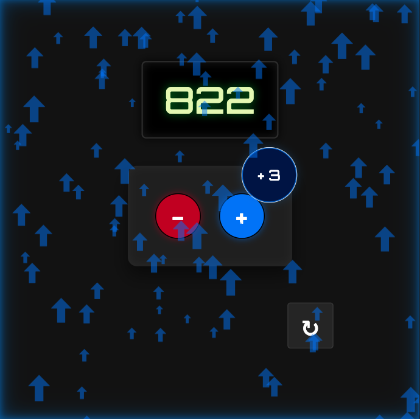

# JavaScript Counter

A simple interactive web application that allows users to increase, decrease and reset a counter value.

The project was built using HTML, CSS and Vanilla JavaScript, with dynamic DOM manipulation and interactive visual effects.

## Features

* Initial counter value set to 0
* Increase and decrease the counter value using the + and - buttons
* Reset the counter value
* Automatically save the counter value using `localStorage`
* Combo system that unlocks +3 and -3 bonus buttons after 5 consecutive clicks in the same direction
* Bonus buttons available for 5 seconds
* Visual effects with colored aura and animated arrows

## Preview



## Technologies Used

* HTML5
* CSS3
* Vanilla JavaScript

## What I Learned

With this project, I practiced:

* Creating HTML elements dynamically with JavaScript (`createElement`)
* Manipulating the DOM
* Building the page structure using `append()`
* Handling user interactions with `addEventListener`
* Using `localStorage` to save and retrieve data
* Managing timers with `setTimeout()` and `clearTimeout()`
* Creating animations and visual effects with CSS and JavaScript

## Project Structure

```text
javascript-counter
│
├── index.html
│
└── assets
    ├── css
    │   └── style.css
    │
    └── script
        └── main.js
```

## How to Run

Clone the repository and open the `index.html` file in your browser.

## Live Demo

You can view the project here:

[View Counter Demo](https://michael-mgc.github.io/Javascript-DOM-counter/)

